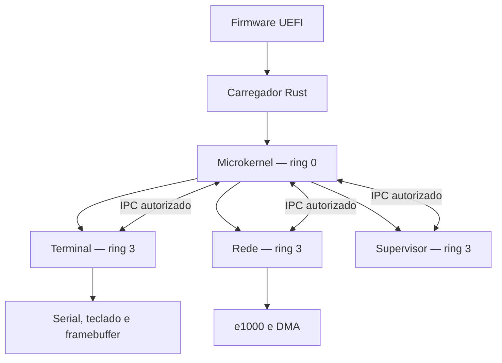

# Arquitetura do Raiz OS

## 1. Objetivo e fronteiras

Construir um SO próprio em Rust, com microkernel próprio, para evoluir de uma
plataforma controlada de pesquisa a um produto integrado. A entrega inicial é
uma imagem que inicia sem outro sistema operacional instalado no convidado.

O firmware da máquina prepara o hardware e chama nosso carregador UEFI. Nosso
carregador prepara a memória e entra no microkernel. Após `ExitBootServices`,
terminal e rede usam implementações do projeto. O firmware não presta os
serviços de console, teclado ou rede usados pelo SO em execução.

Rust, LLVM, QEMU, firmware e padrões como UEFI/ELF/GPT/IP são dependências de
ferramentas, plataforma ou interoperabilidade. Não são um kernel reutilizado.

## 2. Divisão de responsabilidades

| Área | Microkernel | Serviços |
|---|---|---|
| CPU | Contextos, transições, preempção, entrega de tempo | Trabalho das aplicações e serviços |
| Memória | Tabelas de páginas e imposição de permissões | Política de alocação mais rica, bibliotecas de heap |
| Comunicação | Mensagens, identidade de remetente e direitos de envio | Protocolos e significado de cada operação |
| Interrupções | Entrada e encaminhamento; timer e controlador | Tratamento específico dos dispositivos |
| Rede | Arbitragem de acesso ao dispositivo, nunca TCP/IP | Driver de NIC, Ethernet, IP, sockets, DNS etc. |
| Armazenamento | Acesso controlado a recursos físicos | Driver de bloco, filesystem, cache e recuperação |
| Terminal | Nenhuma interpretação de comandos | Teclado, saída, shell e execução de programas |
| Recuperação | Detectar e isolar falha; revogar autoridade | Supervisor decide reiniciar, limitar ou escalar |

Na versão 0.2 ainda há bootstrap e atribuição PCI estáticos no núcleo. O supervisor
administra apenas a recuperação da rede; não há servidor de memória ou criação
geral de processos. A divisão acima inclui o destino arquitetural; os limites da
implementação atual constam na seção seguinte.

## 3. Arquitetura implementada na versão 0.2

Os três serviços são ELFs distintos. Todos enxergam sua imagem a partir da VA
`0x40000000`, mas usam reservas físicas diferentes. Essa igualdade de endereço
virtual é deliberada: o CR3 de cada processo seleciona um mapeamento distinto.
O código e os dados privilegiados permanecem em páginas supervisor.

Cada instância tem uma reserva física estática de 2 MiB. Apenas páginas de segmentos,
stack e informações são habilitadas para userspace; a reserva inteira não é
automaticamente acessível. Texto é RX, dados são RW+NX e informação de boot é
somente leitura+NX. Há guardas junto à pilha. O núcleo ainda mantém mapeamentos
amplos de bootstrap para si; seu endurecimento é um marco separado.

O serviço de terminal contém a interface de comandos e os drivers serial,
teclado e framebuffer. O serviço de rede contém driver e1000 e protocolos. Essa
primeira divisão já mantém esses componentes fora do ring 0, mas uma falha no
driver de rede ainda derruba a pilha de rede colocada no mesmo processo.

O supervisor é um terceiro processo sem portas ou janelas MMIO. Ele recebe
solicitações de administração do terminal e decide quando recuperar a rede. É o
único serviço autorizado a usar os mecanismos de reinício e encerramento da rede.
O grafo IPC permite terminal↔rede e terminal↔supervisor.

### Identidade, geração e orçamento

A ABI 2 identifica a instância por `(geracao << 32) | id`. O ID lógico permanece
2 após reiniciar a rede, mas a geração muda. O kernel preenche a origem real de
mensagens e recusa referências de gerações anteriores. As permissões não são
derivadas apenas do conhecimento desse valor.

Há seis arenas e seis conjuntos de tabelas: terminal, supervisor e quatro
encarnações possíveis da rede. Cada nova rede usa uma arena e tabelas inativas;
as antigas não são reutilizadas até o reboot. A imagem é preparada antes de
revogar a anterior. Ao publicar a nova instância, o kernel limpa a caixa antiga
e remove suas mensagens pendentes das caixas dos demais processos.

Após a inicialização original, existem três reinícios disponíveis. A quarta
tentativa de reinício recebe `RECURSOS` antes de alterar uma rede ainda viva.
É uma reserva estática limitada, não um alocador geral de processos ou memória.

### Hardware delegado

| Serviço | Recursos concedidos |
|---|---|
| Terminal | UART COM1, portas PS/2 0x60/0x64 e janela do framebuffer |
| Rede | Janela MMIO de 128 KiB do e1000 e syscalls PCI restritas ao dispositivo atribuído |
| Supervisor | Reinício/encerramento da rede; sem acesso direto a dispositivos |
| Todos | IPC autorizado, consulta de referências/estados, timer, ceder e finalizar |

As portas são controladas pelo bitmap de I/O no TSS. A rede não recebe as portas
de configuração PCI: consulta registros permitidos por syscalls verificadas
pelo núcleo. O terminal recebe erro de permissão ao tentar a mesma syscall.

**Isso é uma política estática de permissões, ainda não um sistema completo de
capabilities.** Há geração e invalidação de referências de instância. Ainda não
há uma tabela de capabilities delegáveis, transferência/derivação de direitos ou
revogação hierárquica de autoridade. Não se deve descrever o protótipo como um SO
capability-based completo.

### Agendamento e exceções

Há três processos, uma thread por processo e uma CPU. O PIT dispara aproximadamente
100 vezes por segundo. O kernel alterna processos executáveis; um serviço também
pode ceder voluntariamente. Ao entrar em syscall/interrupção, o estado inteiro de
registradores gerais é salvo numa pilha do núcleo atribuída ao processo.

Exceções em CPL 3 marcam somente o serviço como falho; o próximo processo é
selecionado. Falha em CPL 0 continua sendo falha fatal do sistema. Isso é uma
distinção essencial: microkernel não transforma bugs do próprio kernel em falhas
inofensivas.

O ABI inicial usa registradores inteiros, sem contexto FPU/SIMD. Instruções dessa
classe não previstas são impedidas, em vez de compartilhar silenciosamente estado
entre processos. O suporte a aplicações que as usem requer save/restore apropriado.

## 4. O fluxo de um ping

1. O driver de teclado ou serial entrega caracteres ao serviço terminal.
2. O terminal interpreta `ping 10.0.2.2` e valida o endereço.
3. Envia uma mensagem pequena ao endpoint do serviço de rede por `int 0x80`.
4. O microkernel identifica o chamador, valida o destino e copia os valores para
   uma fila limitada. Ele não interpreta pacotes de rede.
5. O serviço de rede consome a mensagem, resolve ARP quando necessário e monta
   Ethernet/IPv4/ICMP.
6. Seu driver publica os descritores DMA e informa o e1000.
7. O e1000 entrega a resposta; o serviço valida o pacote e envia um evento por IPC.
8. O terminal apresenta a resposta.

No protocolo atual o envio é assíncrono e o cliente consulta eventos. Não existe
RPC geral, promessa, socket de aplicação ou timeout associado à solicitação.
Um novo ping pode substituir uma solicitação anterior. Essas limitações precisam
ser resolvidas antes de chamar a API de rede de completa.

## 5. Implicações para desempenho

Separar serviços introduz trabalho: transições de privilégio, troca de CR3,
escalonamento e, quando utilizado, cópia de mensagens. O efeito depende do caminho
da operação e da implementação. Não há fundamento para prometer uma perda fixa
de percentual nem equivalência de desempenho sem medições.

Na v0.2 mensagens contêm poucos inteiros e entram em filas de 16 posições. Pacotes
de rede permanecem no serviço de rede. Isso evita enviar cada byte do pacote pelo
kernel, mas ainda há cópias entre buffers e o driver usa polling. O protótipo
também reconfigura o bitmap de portas e carrega CR3 a cada troca; simplicidade
prevalece sobre otimização nesta etapa.

Para separar driver e pilha ou atender aplicações com tráfego volumoso, o próximo
contrato deverá usar memória compartilhada explicitamente autorizada. IPC levará
controle e identificadores, enquanto anéis de buffers carregarão dados. Será
preciso definir quem pode ler, escrever, entregar e reutilizar cada buffer.
“Zero copy” não elimina sincronização nem validação de propriedade.

Medições futuras devem incluir percentis de latência de IPC, custo de troca de
contexto, justiça de CPU, latência de wake-up, throughput e perda de pacotes sob
pressão. O teste atual verifica correção funcional na máquina emulada, não esses
atributos de produção.

## 6. Implicações para tolerância a falhas

### Isolamento de CPU

O serviço de rede pode sofrer uma instrução inválida ou tentar ler uma página
supervisor. O kernel registra a falha, interrompe aquele processo e preserva o
terminal. Uma nova requisição ao destino morto recebe erro explícito.

### Recuperação limitada implementada

O supervisor oferece modo manual por padrão e modo automático opcional. O modo
automático observa estado falho/finalizado, com até três tentativas por boot e
atrasos de 100, 200 e 400 tiques. O limite global de arenas também vale para
reinícios manuais. Erros que impedem continuar desabilitam a retentativa automática.

`parar-rede` suspende a automação antes de encerrar. `reiniciar-rede` pode substituir
uma rede falha, finalizada ou ainda executável, inclusive em laço sem ceder.
O supervisor não detecta sozinho a ausência de progresso de um processo executável.

As referências de geração e a remoção de mensagens antigas tratam a identidade
da instância. A memória antiga permanece reservada; não há recuperação geral de
recursos nem restauração de estado. Terminal e supervisor não são reiniciáveis.

Uma futura conexão TCP, uma transação de filesystem ou uma operação DMA em
curso não reaparece apenas porque um processo foi recriado. A semântica poderá
ser retentar, cancelar, restaurar de checkpoint ou informar erro ao cliente,
conforme o serviço. A rede atual reinicia com estatísticas e estado de protocolos
vazios; nenhuma operação anterior é retomada automaticamente.

### DMA é uma fronteira adicional

O dispositivo pode acessar memória física sem seguir as tabelas de páginas da
CPU. Dar ao serviço acesso à NIC não confina, por si só, os endereços que ele
pode colocar em descritores DMA. Sem IOMMU, o driver autorizado ainda integra o
conjunto que precisa ser confiável para a segurança da máquina.

O protótipo desabilita bus mastering quando a rede morre ou é substituída e
mantém suas reservas. A instância seguinte recebe nova arena física, reprograma
a placa com DMA desligado e só habilita o tráfego ao concluir a configuração.
Isso evita reutilização dos buffers no exemplo. Não é uma prova de quiescência,
revogação de DMA, inexistência de transações pendentes ou resistência a hardware
malicioso. Antes de reutilizar buffers de um driver falho, será necessário
interromper o dispositivo, drenar/quiescer operações e aplicar confinamento DMA.

## 7. Implicações para segurança e Rust

Rust ajuda a manter invariantes dentro de cada componente, mas não define
automaticamente quem pode acessar um objeto do kernel. Hardware continua exigindo
`unsafe`, MMIO, I/O, barreiras de memória, tabelas de páginas e assembly explícito.
Essas regiões devem ter precondições registradas e wrappers pequenos.

Um `&T`, `String`, `Vec<T>` ou `trait object` de um processo não é uma mensagem
válida para outro processo: o endereço virtual, o proprietário e a vida útil são
locais. A ABI precisa transportar valores com representação definida ou handles
validados. As bibliotecas Rust de alto nível podem ser construídas sobre essa ABI.

O desenho futuro de capabilities deverá incluir tipo de objeto, direitos,
identidade e geração, com validação em cada syscall. O kernel não pode confiar
em um inteiro fornecido pelo cliente como prova de autoridade. Delegação deverá
reduzir direitos; revogação precisará alcançar objetos derivados e referências
em voo conforme a semântica definida.

Não há verificação formal, mitigação completa de canais laterais ou auditoria
de produção nesta entrega. O resultado dos testes delimita a evidência atual.

## 8. Persistência e produto

A ESP FAT32 existe para o firmware localizar o carregador. O kernel não lê essa
partição depois do boot. Portanto, uma imagem com FAT32 não significa que o SO
já tenha serviço de arquivos.

O caminho planejado para persistência é driver de bloco em userspace, interface
de blocos versionada, serviço de arquivos e API de aplicação. Recuperação de
queda de energia deve ser testada. Não há necessidade de inventar um formato
novo de disco para manter o SO independente: implementar um padrão conhecido
continua sendo desenvolvimento próprio.

O produto final terá identidade, versão, imagem e ciclo de atualização unificados.
Internamente poderá haver diversos serviços isolados. Atualizar serviços
separadamente requer compatibilidade dos contratos e mecanismo de rollback;
isso não está implementado na v0.2.

## 9. Próximos marcos

| Marco | Entrega | Critério de conclusão |
|---|---|---|
| 0.2, implementado | Supervisor de rede, referências com geração e reinício limitado | Validar recuperação, recusa de referências antigas e limite sem derrubar rede viva |
| 0.3 | IPC bloqueante, timeouts, notificações de IRQ e quotas | Serviço sem eventos dorme; cliente lento não monopoliza memória/CPU |
| 0.4 | Memória dinâmica, capabilities e revogação | Operações negadas por direitos; recursos são recuperados sem referências obsoletas |
| 0.5 | Driver de bloco e serviço de arquivos | Arquivo preservado após reinício; testes de corrupção e queda controlada |
| 0.6 | Separar driver e pilha de rede, TCP, DHCP e DNS | Conexões/retransmissão sob perdas; sockets de aplicações e buffers autorizados |
| 0.7 | IOMMU e ciclo de vida DMA | Dispositivo não escreve fora do domínio atribuído; recuperação segura de driver |
| Produto | Aplicações, instalação, atualização e matriz de hardware | Atualização recuperável e comportamento documentado em hardware suportado |

Os números são marcos propostos, não prazos prometidos. IOMMU pode precisar ser
antecipada se o próximo objetivo exigir executar drivers não confiáveis.

A etapa 0.2 não entrega um init geral: o kernel ainda cria os três processos
incorporados. Carregamento de aplicações independentes e gerência dinâmica de
memória precisam de marcos próprios antes da etapa de produto.

As decisões detalhadas estão no [ADR 002](ADR-002-CICLO-DE-VIDA.md), e os contratos
estão na [ABI 0.2](ABI-0.2.md). A ABI 0.1 é conservada como registro histórico.

## Fontes técnicas

1. Rust bare metal: https://doc.rust-lang.org/rustc/platform-support/x86_64-unknown-none.html
2. Rust UEFI: https://doc.rust-lang.org/rustc/platform-support/unknown-uefi.html
3. Rust assembly: https://doc.rust-lang.org/reference/inline-assembly.html
4. UEFI Boot Services: https://uefi.org/specs/UEFI/2.10/07_Services_Boot_Services.html
5. Intel SDM: https://www.intel.com/content/www/us/en/developer/articles/technical/intel-sdm.html
6. Intel e1000: https://www.intel.com/content/dam/doc/manual/pci-pci-x-family-gbe-controllers-software-dev-manual.pdf
7. RFC 791: https://www.rfc-editor.org/rfc/rfc791
8. RFC 768: https://www.rfc-editor.org/rfc/rfc768
9. RFC 792: https://www.rfc-editor.org/rfc/rfc792
10. RFC 826: https://www.rfc-editor.org/rfc/rfc826
11. Capabilities: https://docs.sel4.systems/Tutorials/capabilities.html
12. IPC: https://docs.sel4.systems/Tutorials/ipc.html
13. Drivers, MMU, IOMMU e filas de buffers: https://trustworthy.systems/projects/drivers/
14. Rede de teste QEMU: https://www.qemu.org/docs/master/system/devices/net.html

